# 🏗️ Client creator

Clientele can build a project template for an API Client.

It can also generate functions and models from an OpenAPI schema.

## Basic project template

To create a new clientele API client project just use the `start-api` command:

```sh
uv run clientele start-api -o path/to/my_client
```



This will create a new directory with the following file stucture:

```sh
my_client/
    config.py.  # Client configuration
    client.py   # API client functions
    schemas.py  # API models
    MANIFEST.md # Information about the project
```

The only code within these files will be a simple configuration set up and some basic imports.

## OpenAPI project template

The `start-api` command can also be used to scaffold an entire API client integration using an OpenAPI schema.

If you provide a schema then the `start-api` command will generate the same project structure and it will also include:

- All available operations in the `operations` of the OpenAPI spec as fully typed, decorated functions.
- All available models in the `schemas` of the OpenAPI spec as Pyantic models.

```sh
clientele start-api -u https://raw.githubusercontent.com/phalt/clientele/main/example_openapi_specs/best.json -o my_client/
```



### From a URL

Use the `-u` or `--url` argument.

`-o` or `--output` is the target directory for the generated client.

```sh
clientele start-api -u https://raw.githubusercontent.com/phalt/clientele/main/example_openapi_specs/best.json -o my_client/
```

### From a file

Alternatively you can provide a local file using the `-f` or `--file` argument.

```sh
clientele start-api -f path/to/file.json -o my_client/
```

### Async.io

If you prefer an [asyncio](https://docs.python.org/3/library/asyncio.html) client, just pass `--asyncio` to your command.

```sh
clientele start-api -f path/to/file.json -o my_client/ --asyncio
```

### Regenerating

When your API changes, run the same command again with `-r` or `--regen` to update the client in place. Without it, clientele won't overwrite an existing client and will warn you instead. The exact command is also written into your client's `MANIFEST.md`.

```sh
clientele start-api -f path/to/file.json -o my_client/ --regen
```

Then review the git diff before you ship it. Here a new `/widgets/{widget_id}` endpoint was added to the schema:


